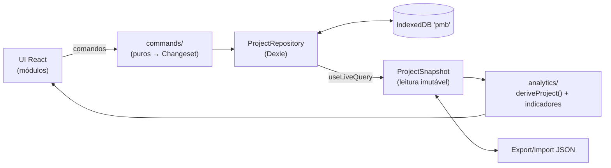

# ARCHITECTURE — Project Management Board (V1) — Consolidada

> Como construir o que está em [SPEC-FINAL.md](SPEC-FINAL.md). Plano inicial em [PLAN-ETAPA-1.md](PLAN-ETAPA-1.md).
> Três decisões-base, definidas pelo usuário:
> 1. **SPA Local-First** — Vite + React 18 + TypeScript estrito + Recharts + IndexedDB/Dexie com padrão Repository + Export/Import JSON.
> 2. **Integração por Projeções Derivadas** — entidades ligadas por ID; Governança e EVM calculados por funções puras testáveis.
> 3. **Registry Estático Tipado** — `ModuleManifest` + schemas Zod por módulo.
>
> Itens **[decisão do arquiteto]** foram escolhidos na consolidação e estão resumidos nos ADRs (§13).

## 1. Modelo de execução

- Aplicação 100% no navegador, hospedável como site estático. Nenhuma requisição de rede depois do carregamento (fontes empacotadas, sem CDN, sem telemetria).
- **Dados**: IndexedDB via Dexie, acessado **somente** por repositórios (`platform/persistence`).
- **Portabilidade**: arquivo JSON versionado (exportar/importar).
- **Evolução**: trocar o adaptador Dexie por um adaptador HTTP (API + banco relacional) mantendo a interface `ProjectRepository`; domínio, projeções e UI não mudam.



## 2. Stack

| Camada | Escolha | Observação |
|---|---|---|
| Build | Vite 5 | site estático em `dist/` |
| UI | React 18.3 | continuidade do protótipo |
| Linguagem | TypeScript 5, `strict` + `noUncheckedIndexedAccess` | sem `any` fora de testes e do ponto único de acesso genérico a coleções |
| Validação | Zod 3 | fonte da verdade dos tipos (`z.infer`): formulários, gravação, importação, settings |
| Persistência | Dexie 4 + `dexie-react-hooks` (`useLiveQuery`) | transações multi-tabela, leitura reativa |
| Rotas | React Router 6, `createHashRouter` | funciona em qualquer hospedagem estática |
| Gráficos | Recharts 2 | Curva S, fluxo de caixa, matriz; **Gantt em SVG próprio** (Recharts não tem Gantt) |
| Ícones | lucide-react | já usado no protótipo |
| Fonte | `@fontsource/ibm-plex-mono` | local |
| Testes | Vitest 2 + Testing Library + jsdom + `fake-indexeddb`; Playwright | §11 |
| Qualidade | ESLint 9 + `eslint-plugin-boundaries`, Prettier 3 | regras de camada §3.2 |

**Fora da stack, de propósito** **[decisão do arquiteto]**:
- **Zustand** — o estado de domínio vive no Dexie e chega à UI por `useLiveQuery`; estado de UI (abas, filtros, diálogo aberto) é `useState`/parâmetros de URL. Uma store global duplicaria a fonte da verdade.
- **react-hook-form** — os formulários são gerados por definições de campos (padrão do protótipo) e validados pelo schema Zod ao salvar; um motor só.
- **date-fns / decimal.js** — datas ISO com aritmética UTC própria (`shared/lib/dates.ts`, ~40 linhas) e dinheiro em inteiros de centavos; `Intl` formata.

## 3. Estrutura de pastas e camadas

```
src/
  shared/                     # sem regra de negócio
    lib/                      # dates.ts money.ts ids.ts format.ts download.ts
    ui/                       # Badge Card KpiTile Dialog ConfirmTypedDialog DataTable ExampleCard fields
    theme/tokens.css
  core/                       # contratos genéricos, não conhece módulos
    ids.ts                    # IDs com marca (PartyId, WorkPackageId…)
    indicators.ts             # Rag, Indicator, Alert, ModuleIndicators, worstRag
    result.ts                 # Result<T,E>, NotAvailable (n/a com motivo)
    module-contract.ts        # ModuleId, ModuleManifest, CollectionDef, RefDef
  modules/<id>/               # governance | scope | schedule | finances | risks | resources | stakeholders
    model/                    # schemas Zod, tipos, enumerações `as const`
    domain/                   # funções puras do módulo (cpm.ts, exposure.ts, quadrant.ts…)
    manifest.ts               # ModuleManifest (sem React)
    index.ts                  # API pública da lógica (model + domain + manifest)
    ui/                       # páginas, formulários, view.tsx (ModuleView)
    examples.ts               # exemplos de preenchimento (nunca persistidos)
  project/                    # o agregado "projeto"
    project.ts config.ts      # Project, ProjectInfo, ProjectConfig, settings resolvidos
    snapshot.ts               # ProjectSnapshot, emptySnapshot, acesso a coleções
    registry.ts               # MANIFESTS: { [K in ModuleId]: ModuleManifest }
    baseline.ts               # tipo Baseline
    changeset.ts              # Changeset, applyChangeset
    integrity.ts              # whereUsed, findIntegrityErrors
    migrations.ts             # SCHEMA_VERSION, migrateExport()
    serialization.ts          # toExport(), parseExport() — usados pela importação E pela carga do IndexedDB
  analytics/                  # projeções que cruzam módulos (puras)
    derive.ts                 # deriveProject(snapshot, statusDate) → DerivedProject
    schedule.ts evm.ts cashflow.ts supplier-panel.ts baseline-snapshot.ts
    alerts/                   # uma regra por arquivo
    indicators/               # um arquivo por módulo + registry.ts (INDICATORS)
    dashboard.ts              # RAG geral, KPIs e alertas dos módulos ativos
  commands/                   # escrita: funções puras snapshot → Changeset
    run.ts                    # runCommand: comando → applyChangeset → validação (puro)
    entities.ts project.ts baseline.ts change-requests.ts guard.ts
  platform/
    persistence/              # db.ts (Dexie), ProjectRepository, DexieProjectRepository
    transfer/                 # export.ts import.ts (JSON)
    react/                    # RepositoryProvider, useSnapshot, useDerived, useCommand
  registers/                  # cadastro genérico: RegisterView, RecordForm, ReferencePicker
  reports/                    # relatório imprimível (Etapa 4)
  app/                        # bootstrap, rotas, layout, VIEWS (registry de UI), telas de núcleo
e2e/
```

Testes ficam ao lado do arquivo (`*.test.ts[x]`); E2E em `e2e/`.

### 3.1 Responsabilidades
- **modules/X (lógica)** conhece só seu domínio. Funções de domínio recebem **tipos de entrada estruturais declarados no próprio módulo** (ex.: `CpmTask` em `schedule/domain/cpm.ts`), compatíveis com as entidades de outros módulos sem importá-los.
- **project** monta o `ProjectSnapshot` a partir das fatias dos módulos e concentra integridade e migrações.
- **analytics** é o único lugar onde dados de módulos diferentes se encontram: adapta snapshot → entradas das funções de domínio e combina os resultados.
- **commands** é o único lugar que produz escrita, sempre como `Changeset` validado.
- **platform** é o único que toca IndexedDB e arquivos.

### 3.2 Regras de dependência (eslint-plugin-boundaries)
Camadas, de baixo para cima — cada uma só importa as anteriores:

`shared` → `core` → `module-logic` (`modules/*/{model,domain,manifest.ts,index.ts}`) → `project` → `analytics` → `commands` → `platform` → `module-ui` (`modules/*/{ui,examples.ts}`) + `registers` + `reports` → `app`

Regras extras:
1. `module-logic` de um módulo **não importa** `module-logic` de outro. Vínculos entre módulos são dados (`RefDef.target`), não imports.
2. `module-ui` importa a própria lógica, `analytics`, `commands`, `platform/react`, `registers`, `shared`; **nunca** a UI de outro módulo.
3. `core`, `module-logic`, `project`, `analytics`, `commands` não importam React, Dexie, `window` nem leem o relógio.
4. Só `platform/persistence` importa Dexie.

## 4. Registry estático tipado

### 4.1 Contrato lógico (sem React)
```ts
type ModuleId = 'governance' | 'scope' | 'schedule' | 'finances' | 'risks' | 'resources' | 'stakeholders';

interface RefDef {
  field: string;                                   // 'supplierId'
  target: { module: ModuleId; collection: string };// { module: 'stakeholders', collection: 'parties' }
  many: boolean;
  required: boolean;
  constraint?: string;                             // nome de predicado declarado no manifest do ALVO: 'isSupplierOrganization'
}

interface CollectionDef<E extends { id: string }> {
  module: ModuleId;
  name: string;                    // 'changeRequests'
  table: string;                   // `${module}_${name}` → tabela Dexie
  cardinality: 'many' | 'one';     // 'one' = registro único por projeto (id = projectId)
  schema: z.ZodType<E>;
  codePrefix?: string;             // 'MUD' → MUD-001 (contador do projeto, nunca reutilizado)
  refs: RefDef[];
  describe(e: E): string;          // 'MUD-003 Troca do inversor'
}

interface ModuleManifest<S extends z.ZodTypeAny = z.ZodTypeAny> {
  id: ModuleId;
  label: string;                   // 'Escopo'
  mandatory: boolean;              // só governance
  requires: ModuleId[];            // schedule → ['scope']
  settingsSchema: S;
  defaultSettings: z.infer<S>;
  collections: CollectionDef<any>[];
  constraints: Record<string, (target: unknown) => string | null>; // predicados sobre registros DESTE módulo; null = ok
}
```
O predicado mora no módulo-alvo (ex.: `stakeholders` declara `isPerson`, `isSupplierOrganization`); quem referencia só cita o nome. Assim `scope` restringe "solicitante é pessoa" sem importar `stakeholders`, e `project/integrity` resolve `MANIFESTS[target.module].constraints[nome]`.

### 4.2 Três registros estáticos, tipados por `ModuleId`
| Registro | Arquivo | Conteúdo |
|---|---|---|
| `MANIFESTS` | `project/registry.ts` | `ModuleManifest` de cada módulo — dirige tabelas Dexie, integridade, validação de settings, export/import |
| `INDICATORS` | `analytics/indicators/registry.ts` | `(ctx: AnalysisContext) => ModuleIndicators` por módulo (KPIs, RAG, alertas) |
| `VIEWS` | `app/registry.ts` | `ModuleView` por módulo: `{ id, sections: SectionDef[], examples, reportSection? }` |

Os três são `{ [K in ImplementedModuleId]: … }`: esquecer um módulo é erro de compilação. `ImplementedModuleId` cresce por etapa (Etapa 1: `governance | scope | schedule | stakeholders`; Etapa 2: os 7 — `ImplementedModuleId = ModuleId`). A divisão em três existe só para respeitar as camadas (lógica sem React; indicadores precisam de `analytics`; telas precisam de React).

### 4.3 Configuração por projeto
```ts
type ProjectConfig = { modules: { [K in ModuleId]?: { enabled: boolean; settings: unknown } } };
```
- `resolveConfig(config, MANIFESTS)` → `{ enabled: Record<ModuleId, boolean>; settings: { [K]: z.infer<S_K> }; warnings: string[] }`. Settings inválidos → `defaultSettings` + aviso, nunca quebra. `mandatory` sempre ligado.
- `setModuleEnabled(config, id, on)` aplica `requires` nos dois sentidos (ligar Cronograma liga Escopo; desligar Escopo desliga Cronograma).
- Desligar: some da navegação, `INDICATORS[id]` não roda, regras de alerta que dependem do módulo não rodam, campos de vínculo para ele ficam ocultos nos formulários. **Dados intactos.**
- Exceção: a coleção `stakeholders.parties` (pessoas e organizações) tem tela sempre disponível em "Configuração → Pessoas e organizações".

## 5. Modelo de dados

### 5.1 Tabelas Dexie
Banco `pmb`. O schema é **gerado** dos manifests:
```
core_projects:   'id'
core_baselines:  'id, projectId'
<module>_<collection>: 'id, projectId'     // uma tabela por CollectionDef
```
Toda entidade persistida carrega `projectId` (no máximo um projeto na V1; prepara o portfólio sem custo).

### 5.2 Projeto
```ts
type Project = {
  id: ProjectId;
  schemaVersion: number;
  info: { name: string; code: string; startDate: IsoDate };
  config: ProjectConfig;
  statusDate: IsoDate | null;           // null = hoje
  counters: Record<string, number>;     // por codePrefix; nunca decresce
  createdAt: string; updatedAt: string;
};
```

### 5.3 Snapshot (leitura)
```ts
type ProjectSnapshot = {
  project: Project;
  baselines: Baseline[];                // ordenadas por versão
  stakeholders: { parties: Record<PartyId, Party>; communications: …; };
  governance:   { profile: GovernanceProfile; norms: …; meetings: …; lessons: … };
  scope:        { requirements: …; wbs: …; deliverables: …; changeRequests: … };
  schedule:     { milestones: … };
  finances:     { budgetLines: …; procurements: … };           // Etapa 2
  risks:        { risks: … };                                   // Etapa 3
  resources:    { resources: …; allocations: … };               // Etapa 3
};
```
- Coleções `many` → `Record<Id, Entity>`; coleções `one` → a entidade (ex.: `governance.profile` = ficha + encerramento + template + estratégia de aquisições).
- `getItems(s, def)` / `setItems(s, def, items)` em `project/snapshot.ts` são o **único** ponto com acesso genérico (cast controlado).

### 5.4 Entidades principais (resumo; campos completos no SPEC §6)
| Módulo | Coleção | Destaques |
|---|---|---|
| stakeholders | `parties` | `z.discriminatedUnion('kind', [Pessoa, Organização])`; organização tem `roles: OrgRole[]` (≥ 1), `taxId`; pessoa tem `organizationId` |
| governance | `profile` (one) | `charter`, `closure`, `documentTemplate`, `procurementPolicy` |
| governance | `norms`, `meetings`, `lessons` | — |
| scope | `requirements` | `deliverableIds[]` |
| scope | `wbs` | `kind: 'Agrupador' \| 'Pacote de trabalho'`, `duration`, `predecessorIds[]`, datas reais, `percentComplete` |
| scope | `deliverables` | `category` + `type` dependente (união discriminada por `category`), `template` só em documentações |
| scope | `changeRequests` | `scheduleImpactDays`, `costImpactCents` (aceitam negativo), máquina de estados |
| schedule | `milestones` | `predecessorIds[]` (pacotes), `manualDate` |
| finances | `budgetLines` | `kind: 'Custo' \| 'Receita'`, `nature: CAPEX/OPEX`, `budgeted`, `actual` |
| finances | `procurements` | `supplierId` (**obrigatório**, `constraint: isSupplierOrganization`), `budgeted`, `committed`, `actual`, `contractStatus`, `deliveryStatus` |
| risks | `risks` | níveis + quantitativos opcionais, vínculos N:N |
| resources | `resources`, `allocations` | — |

### 5.5 Linha de base
```ts
type Baseline = {
  id: string; projectId: ProjectId; version: number; createdAt: string;
  changeRequestId: ChangeRequestId | null;       // null só na v1
  projectFinish: IsoDate | null;
  workPackages: Record<WorkPackageId, { start: IsoDate; finish: IsoDate; duration: number }>;
  milestones:   Record<MilestoneId, { date: IsoDate }>;
  costItems:    Record<string, { budgetedCents: number; currency: string; rate: number }>; // linhas + contratações (Etapa 2)
  deliverables: Record<DeliverableId, { code: string; name: string; plannedDate: IsoDate | null }>;
};
```
Append-only (`core_baselines` nunca recebe update/delete, exceto "apagar dados locais"). A fotografia é calculada por `analytics/baseline-snapshot.ts` (usa o CPM).

### 5.6 Convenções
- IDs: `crypto.randomUUID()`; código legível separado, gerado por `project.counters`.
- Dinheiro: inteiro de centavos + código de moeda; taxa decimal no item; half-even na conversão final (`shared/lib/money.ts`).
- Datas: string ISO `YYYY-MM-DD`, aritmética em UTC; durações inteiras em dias corridos; término inclusivo.
- Percentuais: número 0–100.
- Enumerações: arrays `as const` em `model/`, valores em pt-BR (exibidos e exportados).

## 6. Persistência — Repository sobre Dexie

### 6.1 Porta
```ts
interface ProjectRepository {
  exists(): Promise<boolean>;                         // Dexie.exists('pmb') — não abre nem cria o banco
  loadSnapshot(): Promise<LoadResult>;                // { status: 'vazio' } | { status: 'pronto', snapshot } | { status: 'corrompido', raw, errors }
  commit(cmd: Command, ctx: CommandContext): Promise<Result<void, string[]>>;
  replaceAll(snapshot: ProjectSnapshot): Promise<void>; // importação: limpa tudo e grava numa transação
  readRaw(): Promise<unknown>;                        // recuperação: dump bruto das tabelas
  clearAll(): Promise<void>;                          // db.delete()
}
type Command = (s: ProjectSnapshot, ctx: CommandContext) => Result<Changeset, string[]>;
type CommandContext = { now: string; today: IsoDate; newId: () => string };
```

### 6.2 Escrita = comando puro + Changeset
```ts
type Changeset = {
  project?: Project;                                   // ex.: contadores, config
  puts: { table: string; value: { id: string } }[];
  deletes: { table: string; id: string }[];
  appendBaseline?: Baseline;
};
```
`DexieProjectRepository.commit(cmd)` executa **uma transação `rw` sobre todas as tabelas**:
1. lê o snapshot atual;
2. `runCommand(snapshot, cmd, ctx)` (puro, `commands/run.ts`): `cmd` → `Changeset` (ou erros de regra) → `applyChangeset` → valida cada entidade alterada com o `schema` da coleção → `findIntegrityErrors(novo)`;
3. grava `puts`/`deletes`/`appendBaseline`/`project`; qualquer erro aborta a transação inteira.

Assim as regras ficam testáveis sem banco (comandos e `applyChangeset` são puros) e o repositório é fino. Exemplo da única escrita que atravessa áreas: `applyChangeToBaseline(crId)` devolve `{ appendBaseline: v(n+1), puts: [mudança com status 'Implementada'] }` — atômico.

`commands/guard.ts` envolve todos os comandos: projeto `Encerrado` recusa qualquer escrita exceto `reopenProject`.

### 6.3 Leitura reativa
- `useSnapshot()` = `useLiveQuery(() => repo.loadSnapshot())`; Dexie reexecuta quando qualquer tabela observada muda (inclusive em outra aba).
- `useDerived()` = `useMemo(() => deriveProject(snapshot, statusDate), [snapshot, statusDate])`.
- Com o volume de um projeto (centenas a poucos milhares de registros) ler o snapshot inteiro por mudança é barato; se não for, o ponto de otimização é o `loadSnapshot`, não a UI.

### 6.4 Regras de abertura
- Inicialização chama `exists()`. Se `false`, mostra a tela inicial **sem instanciar consultas** (Dexie criaria o banco ao abrir).
- Abrir falhando (IndexedDB indisponível/bloqueado) → tela "Este navegador não permite salvar dados…".
- Dados que não passam em migração/schema/integridade → `corrompido` → tela de recuperação (exportar bruto via `readRaw`, apagar).

### 6.5 Versões e migrações
- `SCHEMA_VERSION` único para dados e banco. Cada etapa que adiciona coleções incrementa a versão: `db.version(n).stores(buildStores(manifestsDaVersao(n)))`.
- Migrações de dados são funções sobre o **formato de exportação** (`ExportV_n → ExportV_n+1`), usadas pela importação e pelo `.upgrade()` do Dexie (lê tudo → migra → regrava). Uma implementação, dois usos.
- Fixture dourada por versão em `src/project/__fixtures__/export-v<n>.json`; teste garante migração até a atual.
- O dump do banco (`readRaw`) usa o `schemaVersion` **gravado no projeto**, não a constante, para que a migração também rode na carga. As tabelas de cada versão anterior ficam congeladas em `project/migrations.ts` (`STORES_V1`), e `db.version(n).upgrade()` aplica `migrateRows` às linhas — a mesma função da importação. Etapa 2: v1 → v2 adiciona `analysis: null` às partes e os parâmetros padrão de Partes Interessadas. Etapa 3: v2 → v3 (sem tabelas novas; `STORES_V2` congelado) adiciona `reassess: null` aos riscos, `fatStatus/satStatus = 'Não Aplicável'` e datas `null` aos entregáveis físicos e `latePenalty` desativada ao perfil de Governança. Cada `db.version(n).upgrade()` chama `migrateRows(tabela, linhas, n−1, n)`.

## 7. Export / Import JSON

```ts
type ExportFile = {
  format: 'pmb-export';
  schemaVersion: number;
  exportedAt: string;
  project: Project;
  baselines: Baseline[];
  data: Record<string /* table */, unknown[]>;
  checksumSha256?: string; // Etapa 3
};
```
- **Integridade (Etapa 3)**: `checksumSha256` = SHA-256 (hex minúsculo, `crypto.subtle.digest`) do JSON **canônico** (chaves ordenadas em todos os níveis) do arquivo sem o próprio campo — não depende de indentação nem da ordem das chaves. A importação (`parseImportFile`, assíncrona) verifica antes da migração: divergente → recusa com "Integridade SHA-256 não confere…"; ausente → aceita (exportação antiga) e a prévia avisa; sem Web Crypto (contexto inseguro) → exporta sem o campo e importa sem verificar, com aviso.
- **Exportar**: `loadSnapshot` → `toExport()` → JSON indentado → download `pmb-<código-em-slug>-<AAAA-MM-DD>.json`. Exemplos nunca estão no snapshot, logo nunca são exportados.
- **Importar** (`project/serialization.ts#parseExport`, puro; `platform/transfer` só lê o arquivo e grava). A carga do IndexedDB usa o mesmo `parseExport` sobre o dump das tabelas:
  1. `JSON.parse` → falha: "O arquivo não é um JSON válido."
  2. `format !== 'pmb-export'` → "O arquivo não é uma exportação do Project Management Board."
  3. `schemaVersion > SCHEMA_VERSION` → "…versão mais nova da aplicação (versão de dados N; suportada até M)."
  4. `migrate()` → schemas Zod por coleção → `findIntegrityErrors` → falha: "O arquivo contém dados inválidos:" + até 10 itens.
  5. Prévia (nome, código, contagem por coleção) → confirmação de substituição → `replaceAll`.
  Nada é gravado antes do passo 5.

## 8. Projeções derivadas (analytics)

### 8.1 Pipeline
```
snapshot ─► deriveProject(snapshot, statusDate) ─► DerivedProject
              ├─ schedule:   computeSchedule(wbs→CpmTask[]), rollups, marcos (previsão, desvio, situação, crítico)
              ├─ progress:   % físico, % planejado (LB), SPI físico, Curva S física
              ├─ finances:   BAC/PV/EV/AC/índices, resumo orçado×comprometido×realizado, fluxo de caixa  (Etapa 2)
              ├─ suppliers:  supplierPanel por organização                                          (Etapa 2)
              └─ risks/resources: exposição, matriz, carga                                          (Etapa 3)
DerivedProject ─► INDICATORS[módulo ativo](ctx) ─► ModuleIndicators { rag, kpis, alerts }
               ─► dashboard(): worstRag + KPIs + alertas
```
- Todas as funções: `(entrada, statusDate, settings) → resultado`, sem relógio, sem banco; resultados não calculáveis são `null` ou `NotAvailable { reason }`, nunca `NaN`.
- Cada regra de alerta é um arquivo em `analytics/alerts/` exportando `{ id, requires: ModuleId[], evaluate(ctx): Alert[] }` e listada estaticamente.

### 8.2 Onde mora cada cálculo
| Função | Local | Por quê |
|---|---|---|
| `computeSchedule(tasks: CpmTask[], projectStart, statusDate)` | `modules/schedule/domain/cpm.ts` | puro, tipo de entrada próprio |
| `milestoneStatus`, `physicalSpi`, `plannedProgress`, `physicalSCurve`, `scheduleRag` | `modules/schedule/domain` | idem |
| `requirementSituation`, `findCycle`, `deliverableProgress`, `nextCrStatus` | `modules/scope/domain` | — |
| `staleChangeRequests`, `governanceRag` | `modules/governance/domain` | — |
| `computeEvm(packages, baseline, costItems, statusDate)` | `modules/finances/domain/evm.ts` | entradas estruturais (pacote com datas, item com BAC/AC) |
| `riskExposure`, `stakeholderQuadrant`, `allocationLoad` | respectivos `domain/` | — |
| adaptação snapshot → entradas e combinação | `analytics/*.ts` | único ponto que cruza módulos |
| `worstRag` | `core/indicators.ts` | genérico |

## 9. Integridade referencial
`project/integrity.ts` percorre os `refs` de todos os `MANIFESTS`:
- `whereUsed(snapshot, targetId) → EntityRef[]` — bloqueia exclusão e mostra "usado em" (inclui pai na EAP e predecessores).
- `findIntegrityErrors(snapshot) → string[]` — alvo inexistente, alvo de coleção errada, `constraint` violada (ex.: fornecedor não é organização com papel Fornecedor/Prestador; predecessor não é pacote; pai não é agrupador; organização da pessoa não é organização), ciclo na EAP. Mensagens em pt-BR com `describe()`.
- Rodado em toda gravação (§6.2), na importação e na carga.
- Remover papel de fornecedor com contratações falha pela mesma `constraint` (a gravação da organização deixa a contratação inválida).
- Não existe `onDelete: nullify`: toda exclusão de alvo referenciado é bloqueada (SPEC §7.1).

## 10. UI
- Navegação: tela inicial (sem projeto) → Projeto (abas dos módulos ativos, Governança primeiro) → Configuração (módulos, parâmetros, Pessoas e organizações, dados) → Relatório.
- **Cadastro genérico** (`registers/`): tabela resumida + diálogo de formulário gerado de `FieldDef[]` (`text | textarea | number | money | date | boolean | select | multiselect | reference`), com `hint` por campo; salvar chama `upsertEntity` e mostra os erros devolvidos sem fechar.
- `ReferencePicker` lista `describe()` dos registros-alvo com busca e filtro (`constraint`).
- `ExampleCard`: selo "Exemplo"; "Usar como modelo" copia valores com ID novo e vínculos vazios; exemplos vêm de `examples.ts` e não passam por store, comandos, analytics ou exportação.
- Cabeçalho: nome/código, data de status, aviso permanente de armazenamento local.
- Tokens CSS (`--bg #f5f7fa`, `--primary #3f6d8f`, `--ink`, `--ink-soft`, `--red/--amber/--gold/--green/--blue/--gray` + `-soft`); `.tb-mono` = IBM Plex Mono para códigos e números.
- RAG sempre com texto; gráficos com tabela alternativa.
- Relatório: rota `#/projeto/relatorio?modulos=…`, `@media print` A4, `break-before: page` por módulo; cada `ModuleView` fornece `reportSection`.

## 11. Testes (TDD)

| Nível | Alvo | Ferramenta | Meta |
|---|---|---|---|
| Unitário | `shared/lib`, `core`, `modules/*/domain`, `analytics`, `commands`, `project` | Vitest | 100% das regras do SPEC §8–§9 com casos da tabela; cobertura ≥ 95% nessas pastas |
| Integração | `DexieProjectRepository` (commit atômico, exists sem criar banco, replaceAll, clearAll), export/import, migrações | Vitest + `fake-indexeddb` | round-trip idêntico; fixture dourada por versão |
| Componente | cadastro genérico, exemplos, formulários com vínculo, configuração, dados | Testing Library | estados n/a e mensagens exatas |
| E2E | critérios de aceite da etapa | Playwright (Chromium) | 1 cenário por critério |

Sem `MemoryRepository`: o mesmo adaptador Dexie roda sobre `fake-indexeddb` nos testes **[decisão do arquiteto]**. Comandos são testados direto sobre snapshots montados por builders (`aSnapshot().withPackage(...)`).

## 12. Evolução prevista (não construir na V1)
| Necessidade | Preparação já feita |
|---|---|
| Portfólio | toda entidade tem `projectId`; `loadSnapshot(projectId)` vira parametrizado; `analytics` agrega N snapshots |
| Backend/multiusuário | `HttpProjectRepository` com a mesma porta; comandos puros rodam no servidor; tabelas = coleções, `RefDef` = FKs |
| Perfis (responsável, auditor, analista, cliente) | autorização por módulo × ação no `commands/guard.ts` e no servidor |
| Dependências SS/FF/SF, lags, calendários | estendem `CpmTask`/`computeSchedule` sem mudar o contrato |
| Gates, status reports, histórico, Excel, criptografia do arquivo | novas coleções/adaptadores; nenhum exige mudar camadas |

## 13. ADRs

| # | Decisão | Motivo | Consequência |
|---|---|---|---|
| 001 | SPA local-first, Dexie atrás de `ProjectRepository`, export/import JSON | usuário | sem servidor; backup depende do export; troca por HTTP sem tocar domínio |
| 002 | Projeções derivadas; nenhum módulo grava em outro | usuário | todo indicador é função pura testável; só a LB atravessa áreas, por ação explícita e atômica |
| 003 | Registry estático tipado (`MANIFESTS`/`INDICATORS`/`VIEWS` por `ModuleId`) + Zod | usuário | esquecer um módulo é erro de compilação; tabelas Dexie e integridade derivam dos manifests |
| 004 | Uma tabela Dexie por coleção, com `projectId` | arquiteto | portfólio futuro sem migração de forma; comandos e integridade operam no snapshot inteiro |
| 005 | Escrita por comando puro → `Changeset` → transação única validada | arquiteto | regras testáveis sem banco; atomicidade da rebaseline |
| 006 | Sem Zustand, RHF, date-fns, decimal.js, MemoryRepository | arquiteto | uma fonte da verdade (Dexie); menos dependências |
| 007 | Módulos não se importam; `analytics` é o único ponto de cruzamento | arquiteto (ECC) + SP | lint garante; domínio usa tipos estruturais |
| 008 | CPM Término→Início sem lag, dias corridos, término inclusivo, a partir dos pacotes da EAP | SP | simples e verificável à mão; extensível |
| 009 | Mudanças em Escopo; rebaseline só por mudança `Aprovada` | usuário | `applyChangeToBaseline` em `commands/baseline.ts` |
| 010 | Contratação = entidade própria em Finanças, fornecedor obrigatório por ID (organização Fornecedor/Prestador), sem vínculo com linha de orçamento | usuário + arquiteto | sem dupla contagem; painel de fornecedor projetado em Stakeholders |
| 011 | Cadastro de pessoas/organizações sempre disponível | SP | vínculos de responsável/fornecedor não dependem do módulo ligado |
| 012 | Importação com vínculo órfão é recusada | SP | nenhum dado perdido em silêncio |
